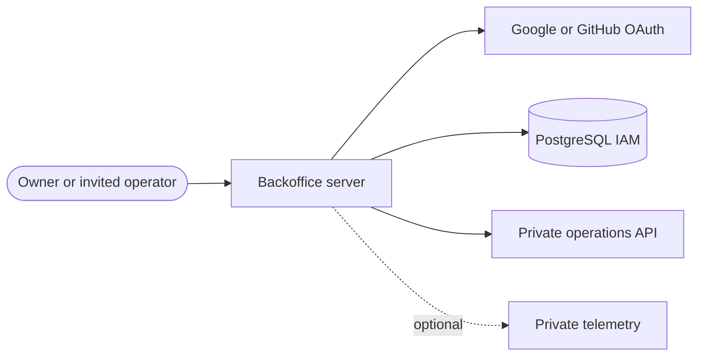

<!-- Variant: PUBLIC -->
<div align="center">
  
  <h1>Pequeverso backoffice</h1>
  <p>Private operations panel for the Pequeverso shopping assistant: OAuth access, roles and a live dashboard.</p>
  <a href="https://github.com/gonzalomartinperez/pequeverso-backoffice/actions/workflows/ci.yml"></a>
  <a href="https://github.com/gonzalomartinperez/pequeverso-backoffice/releases"></a>
  <a href="LICENSE"></a>
</div>

<picture>
  <source media="(prefers-color-scheme: dark)" srcset="docs/verification/backoffice/desktop-dashboard-dark.png">
  
</picture>

## Why

The public conversation lives only in the Pequeverso storefront. The owner and invited
operators still need to know whether the assistant is healthy, how fresh the catalog is and what
it costs, without exposing prompts, answers or buyer data. This application is that private view:
access is by Better Auth OAuth only, every page and server action re-checks the role on the
server, and operations data comes from the API's pinned private contracts, validated at the
adapter boundary. Missing values read "No disponible" and fixture data is labelled synthetic.

## Highlights

- OAuth sign-in (Google, GitHub) with invitation-only admission, no passwords and no implicit account linking.
- Roles and sessions stored in PostgreSQL through append-only migrations in `migrations/`.
- Operations dashboard with health, catalog freshness, runs, latency, tokens and spend, plus an optional telemetry panel.
- Independently disabled site-activity report over bounded aggregates, behind the same IAM guard.
- Architecture boundaries enforced by `scripts/check-boundaries.ts` as part of `npm test`.
- One required CI aggregate (`ci-gate`) over the profiles described in [docs/ci.md](docs/ci.md).

## Architecture



Dependencies point inward through domain, application, adapters and presentation. Only the
server adapters talk to the API and PostgreSQL. Full map:
[docs/explanation/architecture.md](docs/explanation/architecture.md) and the
[diagram sources](docs/explanation/architecture-diagrams.md).

## Quickstart

```bash
nvm use && npm ci                 # Node from .nvmrc, restore dependencies
npm run check                     # lint, types, unit tests, knip, docs and skills checks, build
npm run test:browser              # Playwright with fake identity provider and mock ops data
```

Requirements: Node 24.22.0 (`.nvmrc`), Docker for the local PostgreSQL used by the database and
browser suites. For the preview stack, the PostgreSQL recipe and the real-API reading, follow
[CONTRIBUTING.md](CONTRIBUTING.md) and
[PostgreSQL runtime and restore](docs/how-to/postgres-runtime-and-restore.md).

## Usage

Where it runs: deployment needs the owner's explicit authorization and follows the `vps-ops`
handoff in the [deployment contract](docs/deployment-contract.md). Locally, after `npm run build` and with a
disposable PostgreSQL in `TEST_DATABASE_URL`, `npm run preview:backoffice` serves that build with a fake identity provider ("Proveedor de prueba") and the synthetic
fixture from `scripts/mock-ops.ts`. Set `LIVE_OPS_URL` and `LIVE_OPS_TOKEN` to read a real API
instead.

## Quality

| Gate | Tool | Threshold |
|---|---|---|
| Lint and format | Biome | zero errors and warnings |
| Types | TypeScript 7 (strict) | zero errors |
| Unit and contract tests | `node:test` | all pass |
| Database tests | PostgreSQL integration suite | all pass; merged coverage floors in [docs/ci.md](docs/ci.md) |
| Browser and accessibility | Playwright and axe-core | all pass |
| Dead code | knip | zero findings |
| Secrets and workflows | gitleaks, zizmor | zero findings |

Scores are tracked in the [scorecard](docs/master-plan/scorecard.md); the latest result is the
[CI workflow](https://github.com/gonzalomartinperez/pequeverso-backoffice/actions/workflows/ci.yml).

## Documentation

- Tutorials: none yet.
- How-to: [PostgreSQL runtime and restore](docs/how-to/postgres-runtime-and-restore.md).
- Reference: [permissions](docs/reference/permissions.md), [observability](docs/reference/observability.md),
  [product analytics](docs/reference/product-analytics.md), [runtime baseline](docs/reference/runtime-baseline.md),
  [agent skills](docs/reference/agent-skills.md), [CI](docs/ci.md), [dependencies](docs/dependencies.md).
- Explanation: [architecture](docs/explanation/architecture.md), [authentication](docs/explanation/authentication.md),
  [security design](docs/security.md), [design system](docs/design-system.md), [decisions (ADRs)](docs/decisions/),
  [history](docs/explanation/history/verification-2026-10.md).
- Master plan: [docs/master-plan](docs/master-plan/README.md).

## Ecosystem

| Repository | Role |
|---|---|
| [portfolio](https://github.com/gonzalomartinperez/portfolio) | Public portfolio site |
| [portfolio-assistant-api](https://github.com/gonzalomartinperez/portfolio-assistant-api) | Portfolio assistant API |
| [portfolio-backoffice](https://github.com/gonzalomartinperez/portfolio-backoffice) | Portfolio backoffice |
| [pequeverso](https://github.com/gonzalomartinperez/pequeverso) | Public store site |
| [pequeverso-assistant-api](https://github.com/gonzalomartinperez/pequeverso-assistant-api) | Store assistant API |
| [pequeverso-backoffice](https://github.com/gonzalomartinperez/pequeverso-backoffice) | This repository: store backoffice |
| `vps-ops` (private) | Ops CLI and deploy contract |

## Contributing and security

See [CONTRIBUTING.md](CONTRIBUTING.md), [SECURITY.md](SECURITY.md) and
[CODE_OF_CONDUCT.md](CODE_OF_CONDUCT.md). Agents follow [AGENTS.md](AGENTS.md).

## Scope and limits

- The backoffice serves no public chat, collects no visitor analytics and receives no conversation content, buyer data or provider keys.
- CI fixture evidence does not prove a deployment, real OAuth, TLS cookies, VPS capacity or provider billing.
- Estimated cost comes from reported token usage and is not a reconciled provider invoice.
- Nothing is deployed without explicit owner authorization.

## License

Software is MIT-licensed ([LICENSE](LICENSE)); brand, content and data are reserved in [NOTICE.md](NOTICE.md), and third-party rights are kept in [THIRD_PARTY_NOTICES.md](THIRD_PARTY_NOTICES.md).
